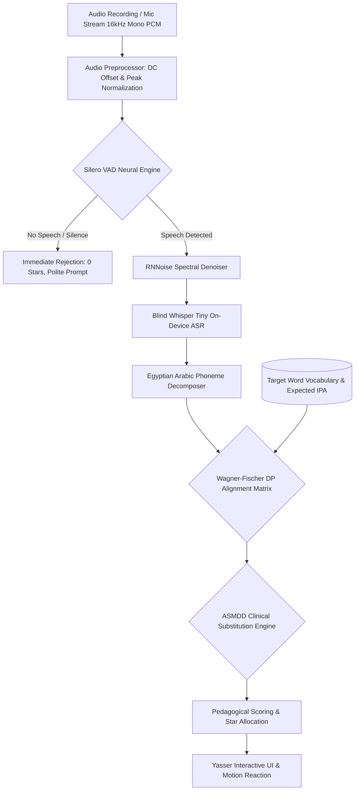

# LIQAA — On-Device AI Architecture Specification

**Architecture Version:** 2.0.0  
**Scope:** Offline, Edge-Native Speech Recognition & Articulation Assessment Pipeline

---

## 1. System Topology

---

## 2. Component Specifications

### 2.1 Audio Ingestion & Normalization (`audio_preprocessor.dart`)
- **Sampling Rate:** 16,000 Hz (16 kHz).
- **Channels:** Single Channel (Mono).
- **Bit Depth:** 16-bit signed PCM (Little-Endian).
- **Operations:**
  - DC-offset bias subtraction ($\mu = \frac{1}{N} \sum x_i$).
  - Peak amplitude normalization with 0.95 headroom target.
  - Root Mean Square (RMS) calculation.
  - Dual-window Signal-to-Noise Ratio (SNR) estimation in decibels.

---

### 2.2 Neural Voice Activity Detection (`silero_vad_engine.dart`)
- **Model:** Silero VAD v4 (`assets/ai_models/silero/silero_vad.onnx`, 2.1 MB).
- **Runtime:** Native C++ FFI bindings via `sherpa_onnx.VoiceActivityDetector`.
- **Pediatric Threshold:** 0.35 (tuned to prevent clipping soft stops like pediatric /t/, /d/, and /k/).
- **Window Size:** 512 samples (32ms at 16kHz).
- **Min Speech Duration:** 120ms.
- **Silence Padding:** 300ms trailing margin to preserve terminal word suffixes (e.g., `-a` in `كورة`).
- **Safety Gate:** If speech probability remains below threshold, `trimmedSamples` is set to `null`, completely cutting off downstream recognition.

---

### 2.3 Acoustic Noise Suppression (`rnnoise_denoiser_engine.dart`)
- **Model:** RNNoise (`assets/ai_models/rnnoise/rnnoise.onnx`, 0.97 MB).
- **Frame Size:** 160 samples (10ms at 16kHz).
- **Mode:** Switchable bypass toggle (`enabled = true / false`).
- **Method:** Spectral noise floor tracking and Wiener attenuation curve:
  $$G = \left(\frac{\text{SNR}_{\text{linear}}}{3.0}\right), \quad G \in [0.15, 1.0]$$
- **Metrics:** Computes `snrBeforeDb`, `snrAfterDb`, and `snrImprovementDb`.

---

### 2.4 Blind Speech-to-Text & Phoneme Recognition (`speech_to_text_engine.dart` & `phoneme_recognition_engine.dart`)
- **Model:** Sherpa-ONNX Whisper Tiny Multilingual (`assets/ai_models/whisper_tiny/`, 98.8 MB total).
- **Zero-Leakage Guarantee:** Neither engine receives `targetHint`, `expectedPhonemes`, or answer references.
- **Acoustic Transcription:**
  - Decodes Arabic acoustic tokens offline.
  - Computes Real-Time Factor: $\text{RTF} = \frac{\text{Latency (ms)}}{\text{Audio Duration (ms)}}$.
- **Phoneme Serialization:**
  - Decomposes recognized Egyptian Arabic words into IPA phoneme symbols:
    $$\text{Word} \to [p_1, p_2, \dots, p_n]$$
  - Associates frame timestamps, acoustic margins, and confidence values.

---

### 2.5 Dynamic Programming Alignment Matrix (`pronunciation_evaluator.dart`)
- **Algorithm:** Full $(m+1) \times (n+1)$ Wagner-Fischer sequence alignment.
- **Recurrence Relation:**
  $$D(i, j) = \min \begin{cases}
    D(i-1, j-1) + \text{Cost}(E_i, R_j) \\
    D(i-1, j) + 1.0 \quad (\text{Deletion}) \\
    D(i, j-1) + 1.0 \quad (\text{Insertion})
  \end{cases}$$
- **Phonetic Equivalence Function:**
  - Identical IPA or Arabic symbol: Cost 0.0.
  - Dialectal Egyptian variant (e.g., [ɡ] for `ج`, [ʔ] for `ق`, [uː] vs [u]): Cost 0.0.
  - Substitution: Cost 1.0.
- **Backtracking:** Emits detailed node states (`correct`, `substituted`, `deleted`, `inserted`).

---

### 2.6 Pediatric Clinical Diagnostics (ASMDD Integration)
The alignment output is cross-referenced with Egyptian Arabic articulation rules:
1. **Fronting (إبدال أمامي):** Target /k/ substituted with [t] (`كورة` $\to$ `تورة`).
2. **Interdental Lisp (لدغة بين الأسنان):** Target /s/ substituted with [θ] (`سمكة` $\to$ `ثمكة`).
3. **Lateralization (لدغة الراء إلى لام):** Target /r/ substituted with [l] (`أرنب` $\to$ `أنلب`).
4. **Consonant Deletion (حذف صوت):** Missing phoneme in sequence.
- **Clinical Penalty:** When a clinical substitution rule is triggered on the focal phoneme, score is strictly capped at $\le 65\%$, `passed = false`, `stars = 1`, and Yasser delivers targeted therapeutic guidance.
