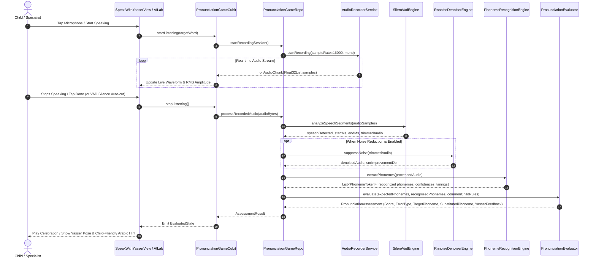

# LIQAA — AI Subsystem Architecture Specification

## 1. Architectural Philosophy

The LIQAA AI subsystem adheres strictly to a **Feature-First, Domain-Free Architecture** using the **Cubit and Repository Pattern**.
In accordance with non-negotiable architectural mandates:
- **No Domain Layer:** No `domain/` directories, no abstract use-case classes, no separate domain entities decoupled from models.
- **Strict Data Flow:**
  $$\text{UI / View} \longrightarrow \text{Cubit} \longrightarrow \text{Repository} \longrightarrow \text{AI Engine / Audio Source}$$
- **Zero Cloud Leakage:** All inference runs within the device memory boundary without sending audio data to external networks.

---

## 2. Component Diagram & Directory Layout

```text
lib/
├── core/
│   └── ai/
│       ├── audio_recorder_service.dart     # 16kHz PCM audio capture & streaming
│       ├── audio_preprocessor.dart         # Normalization, DC offset removal & resampling
│       ├── silero_vad_engine.dart          # Voice Activity Detection & silence trimming
│       ├── rnnoise_denoiser_engine.dart    # Audio noise reduction & SNR computation
│       ├── phoneme_recognition_engine.dart # Streaming Zipformer CTC acoustic recognizer
│       ├── speech_to_text_engine.dart      # Word-level ASR engine
│       ├── pronunciation_evaluator.dart    # Levenshtein phonetic alignment & diagnostic classifier
│       ├── ai_model_manager.dart           # Model lifecycle, disk management, verification
│       └── models/
│           ├── audio_processing_result.dart # Audio metrics (SNR, RMS, speech timestamps)
│           ├── phoneme_token.dart          # Phonetic units, IPA codes, confidence, start/end ms
│           ├── pronunciation_assessment.dart# Error classification, alignment list, score
│           ├── vocabulary_word.dart        # Target word, phonetic breakdown, child error rules
│           └── ai_model_info.dart          # Model metadata, download status, memory status
│
├── features/
│   ├── ai_lab/
│   │   ├── cubits/
│   │   │   ├── ai_lab_cubit.dart
│   │   │   └── ai_lab_state.dart
│   │   ├── repos/
│   │   │   └── ai_lab_repository.dart
│   │   └── views/
│   │       ├── ai_lab_hub_view.dart        # Navigation dashboard
│   │       ├── model_manager_view.dart     # Screen 1: Status, sizes, disk path, load/unload
│   │       ├── mic_vad_view.dart           # Screen 2: Live recording, waveform, VAD timestamps
│   │       ├── noise_reduction_view.dart   # Screen 3: Raw vs Denoised, SNR calculation
│   │       ├── phoneme_recognition_view.dart# Screen 4: Zipformer CTC phoneme analysis
│   │       ├── speech_to_text_view.dart    # Screen 5: Sentence ASR & RTF metrics
│   │       ├── model_comparison_view.dart  # Screen 6: V2 vs V3 vs Moonshine comparison
│   │       └── full_pipeline_view.dart     # Screen 7: End-to-end execution & JSON export
│   │
│   └── pronunciation_game/
│       ├── cubits/
│       │   ├── pronunciation_game_cubit.dart
│       │   └── pronunciation_game_state.dart
│       ├── repos/
│       │   └── pronunciation_game_repository.dart
│       ├── views/
│       │   └── pronunciation_game_view.dart # Child-friendly Egyptian Arabic interactive game
│       └── widgets/
│           ├── yasser_speech_feedback_card.dart
│           ├── phonetic_breakdown_pill.dart
│           ├── sound_waveform_wave.dart
│           └── celebration_confetti_overlay.dart
```

---

## 3. Detailed Data Pipeline Flow



---

## 4. Phonetic Alignment & Error Classification Algorithm

Let $E = (e_1, e_2, \dots, e_m)$ be the sequence of expected phonemes for the target word, and $R = (r_1, r_2, \dots, r_n)$ be the sequence of phonemes recognized by the Zipformer CTC acoustic model.

The alignment matrix $D \in \mathbb{R}^{(m+1) \times (n+1)}$ is computed via weighted dynamic time warping:

$$D(i, j) = \min \begin{cases}
D(i-1, j) + \text{Cost}_{\text{del}}(e_i) \\
D(i, j-1) + \text{Cost}_{\text{ins}}(r_j) \\
D(i-1, j-1) + \text{Cost}_{\text{sub}}(e_i, r_j)
\end{cases}$$

Where the substitution cost $\text{Cost}_{\text{sub}}(e_i, r_j)$ accounts for phonetic feature similarity:
- $\text{Cost} = 0.0$ if $e_i = r_j$ (Exact match)
- $\text{Cost} = 0.5$ if $e_i$ and $r_j$ share place and manner of articulation (e.g. voicing distinction like $[t] \leftrightarrow [d]$)
- $\text{Cost} = 1.0$ for non-homorganic substitutions (e.g. fronting $[k] \rightarrow [t]$)

### Diagnostic Error Types:
1. **Correct ($\text{Accuracy} \ge 90\%$):** Sequence matches without clinical error.
2. **Substitution (إبدال):** An expected phoneme $e_i$ is replaced by an erroneous phoneme $r_j$ (e.g., كورة $[k] \rightarrow [t]$ تورة).
3. **Deletion (حذف):** An expected phoneme $e_i$ is dropped without corresponding realization (e.g., أرنب $[r] \rightarrow \emptyset$ أنلب / أونب).
4. **Insertion (إضافة):** An intrusive consonant is inserted into the sequence.
5. **Distortion (تشويه):** Acoustic confidence is low ($p_i < 0.40$), indicating imprecise or slurred articulation.
