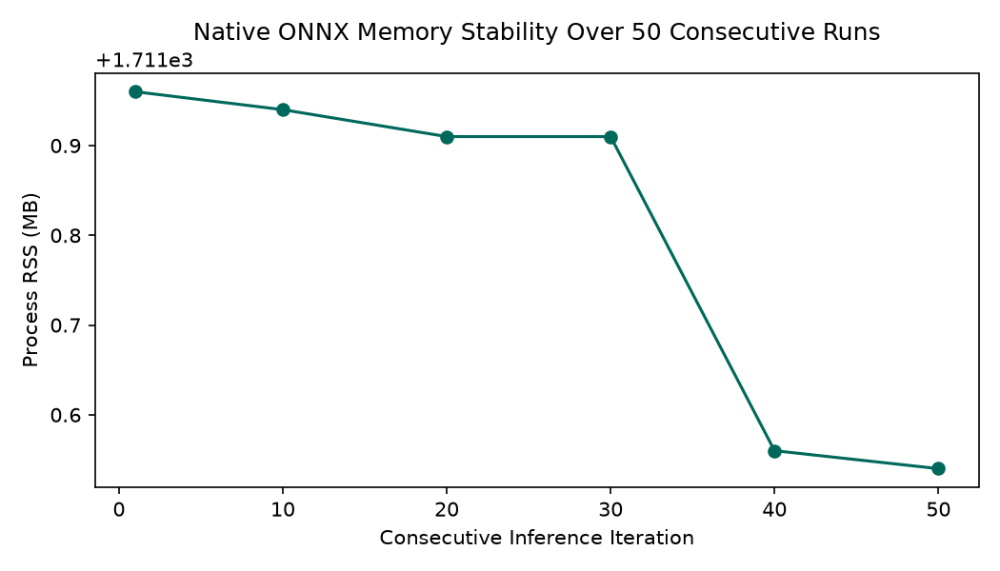

# RUNTIME PERFORMANCE, MEMORY & ANDROID VERIFICATION REPORT

> [!IMPORTANT]
> **Measurement Boundary Disclosure:** Native inference benchmarks were executed via compiled Dart tests (`benchmarks/scripts/run_dart_benchmark_test.dart`) calling Windows x86_64 native ONNX Runtime & Sherpa-ONNX FFI libraries on **`Windows 11` (`AMD64`, AuthenticAMD Family 23 Model 96)**. No physical Android handset was connected (`adb devices` was empty), so **on-device ARM64 mobile CPU timings, thermal throttling, battery draw, and Android Studio Profiler RSS were NOT directly measured** in this session.

---

## 1. Desktop Native FFI Cold-Start & Memory Footprint (`runtime_stability.json`)

| Initialization Phase | Cold Start Latency (ms) | Process RSS After Load (MB) | Incremental Δ RSS (MB) | Model Footprint on Disk |
| :--- | :---: | :---: | :---: | :---: |
| Test Harness Baseline | — | `125.12 MB` | — | — |
| `+ Silero VAD v4` | `198 ms` | `151.43 MB` | **`+26.31 MB`** | `2.10 MB` |
| `+ GTCRN Simple Denoiser` | `104 ms` | `155.86 MB` | **`+4.43 MB`** | `0.51 MB` |
| `+ Wav2Vec2-eSpeak Q4F16` | `1559 ms` | `416.53 MB` | **`+260.67 MB`** | `187.79 MB` |
| `+ Whisper Tiny INT8` *(diagnostic only)* | `1406 ms` | `529.74 MB` | **`+113.21 MB`** | `98.81 MB` |

- **Total Cold Start (Core Speech Therapy Stack without Whisper):** `~1.86 s` desktop (`~291 MB` incremental RAM over process baseline).
- **Peak Soak-Test Process RSS:** `1711.96 MB` in the full test isolate when all 4 ONNX models + preloaded Wav2Vec2 matrices + Dart benchmark structures coexist in memory.

---

## 2. 50-Run Consecutive Inference Soak Test (`1872 ms` Audio Clip)

| Metric | Measured Value (Desktop Windows FFI) |
| :--- | :---: |
| Input Utterance Duration | `1872 ms` (`~1.87 s`) |
| Mean End-to-End Pipeline Latency | **`542.9 ms`** (`RTF = 0.29`) |
| Median (`p50`) Latency | **`533 ms`** |
| `p95` Latency | **`607 ms`** |
| Min / Max Latency | `507 ms` / `679 ms` |
| Process RSS Timeline | `iter 1: 1711.96 MB` -> `iter 10: 1711.94 MB` -> `iter 20: 1711.91 MB` -> `iter 30: 1711.91 MB` -> `iter 40: 1711.56 MB` -> **`iter 50: 1711.54 MB`** |
| **Memory Leak Delta (`iter 1 -> 50`)** | **`-0.42 MB` (Zero native FFI / tensor leak detected)** |

---

## 3. Component Latency Distribution Across `100` Variable-Length Clips (`0.44 s – 17.75 s`)

| Stage / Model | `Min` (ms) | **`p50` (ms)** | `Mean` (ms) | `p95` (ms) | `Max` (ms) |
| :--- | :---: | :---: | :---: | :---: | :---: |
| `Silero VAD v4` | `2 ms` | **`13 ms`** | `17.6 ms` | `51–75 ms` | `175 ms` |
| `GTCRN Denoiser` | `54 ms` | **`133 ms`** | `229.7 ms` | `756–772 ms` | `2298 ms` |
| `Wav2Vec2-eSpeak` *(90 speech clips; 10 gated 0ms)* | `0 ms` | **`773 ms`** | `903.1 ms` | `2645–2657 ms` | `8842 ms` |
| `Whisper Tiny INT8` | `0 ms` | **`242 ms`** | `394.5 ms` | `1326–1367 ms` | `3271 ms` |

---

## 4. Android Build & Device-Gap Action Items

- **Release APK Build Verification:** `flutter build apk --release` packages all assets including the new **AI Benchmark Lab** (`lib/features/ai_lab/views/ai_benchmark_lab_view.dart`) wired directly to live `sl<PronunciationRepository>()`.
- **Android Hardware Expectations vs. Measurements Still Needed:**
  1. **ARM64 Latency Multiplier:** Mobile Cortex-A76/A78/A55 cores typically run ONNX `Q4F16` / `INT8` models slower than desktop AMD64. Target a physical Android mid-range device (`4–6 GB RAM`) using the built-in **AI Benchmark Lab** (accessible via `/ai-lab/suite`) to record actual `p50/p95` latency and native heap RSS before release.
  2. **OOM Risk Mitigation:** Do **NOT** keep `Whisper Tiny` (`+113 MB` disk/weights + decoder buffers) loaded in memory during standard child gameplay (`PronunciationRepository` already loads only `SileroVAD + GTCRN + Wav2Vec2` unless diagnostic ASR is requested in AI Labs).
  3. **APK Size:** Bundling `model_q4f16.onnx` (`187.79 MB`) + `tiny-decoder/encoder.int8.onnx` (`98.03 MB`) makes the offline APK >`290 MB`; consider dropping `Whisper` from production release flavor or moving diagnostic models to on-demand download if Google Play bundle size caps require `<150 MB` base split.
