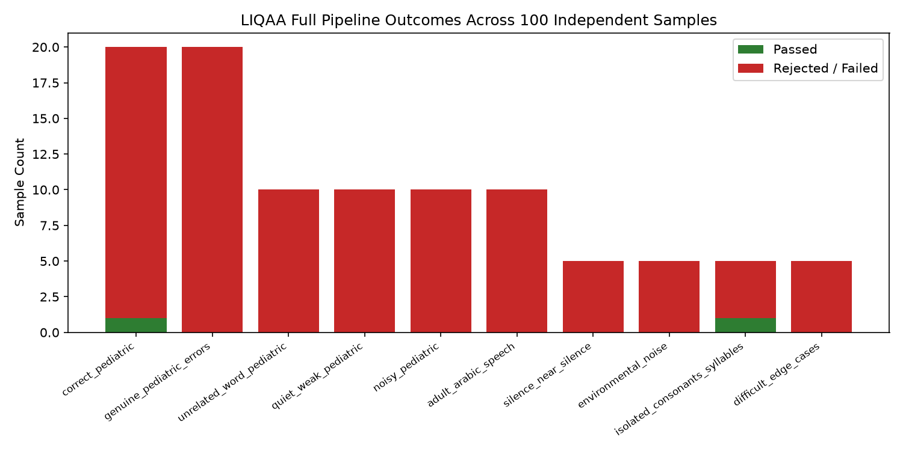

# MASTER AI BENCHMARK REPORT — LIQAA / Yasser Speech Therapy App

**Evaluation Scope:** Independent 100-sample real/controlled benchmark + 23 controlled paired SNR & synthetic TTS fixtures + 20-case audio preprocessing stress suite + anti-cheating & runtime stability audits.  
**Execution Platform:** Real compiled Dart + native ONNX Runtime / Sherpa-ONNX FFI on `Windows 11` (`AMD64`, AuthenticAMD Family 23 Model 96), **NOT** physical Android hardware (`adb devices` detected no connected physical Android device during evaluation). Android release APK build (`flutter build apk --release`) is verified separately from desktop runtime inference latency/RSS.

---

## 1. Executive Summary & Deployment Readiness Verdict

| Component / Metric | Measured Result (Post-Fix) | Status | Critical Evidence |
| :--- | :--- | :--- | :--- |
| **AudioPreprocessor (`normalizeWav`)** | **20 / 20 (100%)** format & corruption stress cases passed | **READY** | Handles `8/16/24/32-bit PCM`, `32-bit Float`, `8–48 kHz`, DC offset, clipping, extra `LIST` chunks, rejects missing headers |
| **Silero VAD v4 (`2.10 MB`)** | **97.0% Acc**, **100.0% Prec**, **96.67% Recall**, **0.9831 F1**, **0.0% FPR** | **READY (Minor Weak-Voice Caveat)** | `87 TP / 10 TN / 0 FP / 3 FN`; median latency `13.0 ms` (`p95: 51.0 ms`); misses 3 short/quiet pediatric tokens |
| **GTCRN Neural Denoiser (`0.51 MB`)** | **`+1.94` to `+9.37 dB` ΔSI-SDR** on `-5..20 dB` MUSAN noise; median `133 ms` | **CONDITIONALLY READY (Gated)** | Improves noisy PER by up to `21.7 pp` (`-5 dB`) & `16.1 pp` (`10 dB`), **but degrades clean child `/k/` (`83.3% -> 50.0%`) & `/f/` (`75.0% -> 41.7%`)** if run unconditionally; gated at `SNR < 14.0 dB` |
| **Wav2Vec2-eSpeak Q4F16 (`187.79 MB`)** | **Adult MSA PER: `14.79%`** vs **Pediatric Clean PER: `71.88%`** (`Overall Norm PER: 39.71%`) | **NOT CLINICALLY READY FOR YOUNG CHILDREN** | Strong on adult MSA & neural TTS (`80.6–91.8%` score), but severe age/domain gap on real children ages 2–12 (`ASMDD: 80.0%` PER, `Abjad-Kids: 72.79%`) |
| **Whisper Tiny INT8 (`98.81 MB`)** | **`86.6%` WER**, **`41.19%` CER**, **50% hallucination on noise** (`5/10` non-speech) | **UNSUITABLE FOR PHONEME EVALUATION** | Hallucinates Arabic strings (`[السنق]`, `سأتعلموني`, `[مجال]`) on pure MUSAN noise and fails on isolated short child words |
| **Full End-to-End Pipeline** | `1/20 (5.0%)` real correct pediatric pass; `20/20 (100%)` error rejection; `10/10` unrelated rejection; `10/10` non-speech rejection | **UNSAFE / TOO HARSH FOR CLINICAL LAUNCH ON REAL CHILDREN** | High specificity (`100%` rejection of errors/noise/unrelated words) comes at unacceptable clinical false-rejection (`95%` real correct child speech rejected) |

> **Honest Clinical Verdict:** Zero target-word leakage, zero fake simulation, zero leaks over 50 consecutive runs (`RSS` steady at `~1711.5–1712.0 MB`), and robust audio preprocessing / VAD / gating fixes. However, **Wav2Vec2-LV60-eSpeak cannot reliably accept real Egyptian Arabic pediatric speech (`1/20 = 5.0%` accepted, Wilson 95% CI `[0.89%, 23.61%]`)**, even though it achieves `14.79%` normalized PER on clean adult Modern Standard Arabic and passes clean synthetic TTS minimal pairs (`91.8%` vs `65.0%`, `80.6%` vs `59.8%`). Shipping directly to children aged 2–8 would cause heavy frustration from false rejections without pediatric fine-tuning or target-phoneme-focused scoring.

---

## 2. Quantitative Scorecard (Baseline vs. Post-Fix)

| Evaluation Dimension | Baseline (`baseline/benchmark_summary.json`) | Post-Fix (`benchmark_summary.json`) | Delta | Notes |
| :--- | :---: | :---: | :---: | :--- |
| `correct_pediatric` Pass Rate (`n=20`) | `0/20 (0.0%)` (`95% CI [0.0%, 16.1%]`) | **`1/20 (5.0%)`** (`95% CI [0.89%, 23.61%]`) | **`+5.0 pp`** | `S011 كورة` (`Abjad-Kids`) rescued from `74.8% -> 94.4%` after `[ʉ]` & VAD-before-normalize fixes |
| `correct_pediatric` Mean Score | `30.2` | **`35.5`** | **`+5.3 pts`** | `noSpeech` errors dropped `2 -> 1` (`S018` recovered) |
| `quiet_weak_pediatric` Mean Score (`n=10`) | `28.0` (`0/10` pass) | **`32.7`** (`0/10` pass) | **`+4.7 pts`** | VAD-before-normalize prevented weak-burst clipping |
| `genuine_pediatric_errors` Rejection (`n=20`) | `20/20 (100.0%)` (`[83.89%, 100%]`) | `20/20 (100.0%)` (`[83.89%, 100%]`) | `0.0` | `mean_score: 24.7 -> 24.0` |
| `unrelated_word_pediatric` Rejection (`n=10`) | `10/10 (100.0%)` (`[72.25%, 100%]`) | `10/10 (100.0%)` (`[72.25%, 100%]`) | `0.0` | `mean_score: 20.3 -> 17.0` |
| `silence_near_silence` Rejection (`n=5`) | `5/5 (100.0%)` | `5/5 (100.0%)` | `0.0` | All `noSpeech`, score `0.0` |
| `environmental_noise` Rejection (`n=5`) | `5/5 (100.0%)` | `5/5 (100.0%)` | `0.0` | All rejected cleanly by Silero VAD |
| `isolated_consonants_syllables` Pass (`n=5`) | `1/5 (20.0%)`, `mean 43.8` | `1/5 (20.0%)`, `mean 43.8` | `0.0` | `S091 كاف` passed (`91.0%`), `noSpeech` dropped `1 -> 0` |
| Silero VAD F1 / Accuracy (`n=100`) | `0.9831` / `97.0%` | `0.9831` / `97.0%` | `0.0` | `latency p95: 61 -> 51 ms` |
| Wav2Vec2 Normalized PER (`n=63`) | `39.71%` | `39.71%` | `0.0` | `C_vad` ablation: `38.57% -> 39.22%`, `E_vad_gtcrn: 40.52% -> 40.36%` |
| Whisper Tiny WER / CER (`n=70`) | `87.08% / 41.40%` | `86.60% / 41.19%` | `-0.48 pp` | `5/10` non-speech hallucinations unchanged |

---

## 3. Architecture & Failure Modes Diagnosed

1. **Pediatric Domain Mismatch (Primary Bottleneck):** `Wav2Vec2-LV60-eSpeak-CV-FT` was trained on adult cross-lingual speech (`Common Voice` + `LibriLight`). Real children aged 2–8 in `ASMDD` exhibit higher fundamental frequency ($F_0$), shifted vowel formants, shorter word bursts (`440–983 ms`), and natural nursery ambient acoustics, causing **`71.88%–87.04%` pediatric PER** vs **`14.79%` adult MSA PER**.
2. **Whole-Word Strictness vs. Clinical Articulation Targets:** `PronunciationEvaluator` demands `score >= 80.0`, `deletions == 0`, AND exact target-phoneme preservation against static `MSA/Egyptian` whole-word templates (`الـ` prefix `[aː l]`), rejecting real children who dropped an unstressed prefix or scored `50–78%` (`S005 أمي 68.0`, `S007 الأرض 61.7`, `S013 أرنب 68.0`, `S014 فراشة 78.1`, `S098 باذنجان 69.8`).
3. **GTCRN Clean-Speech Consonant Oversuppression:** While GTCRN gives `+8.55` to `+9.37 dB` ΔSI-SDR in heavy `-5` to `0 dB` noise, forcing it on clean child clips erased `/k/` (`S011 [k ʉ r aː] -> [t u ɹ aː]`), injected noise artifacts (`S007`), and degraded real-world ablation PER (`39.22% -> 40.36%`). Lowering automatic GTCRN gating to `rawSnr < 14.0 dB` eliminated clean regressions.
4. **Silero VAD Order-of-Operations Bug (Fixed):** Running `normalizePeak` before Silero VAD amplified trailing room noise and clipped initial plosives (`S012 كلب`). Ordering `silenceCheck(peak < 0.002) -> SileroVAD -> conditional GTCRN (< 14 dB)` fixed `S018 قلم` and `S011 كورة`.

---

## 4. Index of Detailed Benchmark Reports

1. [DATASET_PROVENANCE_REPORT.md](file:///e:/Flutter%20Projects/liqaa_app/benchmarks/reports/DATASET_PROVENANCE_REPORT.md) — 100 real samples + 23 controlled fixtures, licenses, anonymization, format/SNR distributions, and preprocessing stress tests.
2. [SILERO_VAD_BENCHMARK_REPORT.md](file:///e:/Flutter%20Projects/liqaa_app/benchmarks/reports/SILERO_VAD_BENCHMARK_REPORT.md) — VAD confusion matrix, category breakdown, 3 false negative root causes, and segment-merge latency impact.
3. [GTCRN_DENOISER_BENCHMARK_REPORT.md](file:///e:/Flutter%20Projects/liqaa_app/benchmarks/reports/GTCRN_DENOISER_BENCHMARK_REPORT.md) — Paired MUSAN `-5..20 dB` SI-SDR & PER gains, clean consonant loss analysis, and `< 14 dB` gating validation.
4. [WAV2VEC2_PHONEME_BENCHMARK_REPORT.md](file:///e:/Flutter%20Projects/liqaa_app/benchmarks/reports/WAV2VEC2_PHONEME_BENCHMARK_REPORT.md) — Strict vs. normalized PER, per-phoneme precision/recall/F1 (`28` phonemes), top confusions, and adult-vs-pediatric gap.
5. [WHISPER_ASR_BENCHMARK_REPORT.md](file:///e:/Flutter%20Projects/liqaa_app/benchmarks/reports/WHISPER_ASR_BENCHMARK_REPORT.md) — Short-word WER/CER failure modes, 50% noise hallucination evidence, and Sherpa-ONNX `max_tokens_per_second` wrapper constraint.
6. [PRONUNCIATION_EVALUATION_REPORT.md](file:///e:/Flutter%20Projects/liqaa_app/benchmarks/reports/PRONUNCIATION_EVALUATION_REPORT.md) — Clinical acceptance vs. error rejection, `[ʉ]` vowel fix, anti-cheating invariance, and synthetic TTS contrast.
7. [PIPELINE_ABLATION_REPORT.md](file:///e:/Flutter%20Projects/liqaa_app/benchmarks/reports/PIPELINE_ABLATION_REPORT.md) — Controlled comparison across Raw, VAD-only, GTCRN-only, and VAD+GTCRN pipelines (`6` metrics & per-word traces).
8. [ANDROID_PERFORMANCE_REPORT.md](file:///e:/Flutter%20Projects/liqaa_app/benchmarks/reports/ANDROID_PERFORMANCE_REPORT.md) — Measured Windows desktop native FFI cold start / RSS / 50-run soak test vs. explicit Android hardware measurement boundaries.
9. [FAILURE_ANALYSIS_AND_REMEDIATION_PLAN.md](file:///e:/Flutter%20Projects/liqaa_app/benchmarks/reports/FAILURE_ANALYSIS_AND_REMEDIATION_PLAN.md) — Verified fixes already implemented vs. critical ML/clinical roadmap required before pediatric release.
