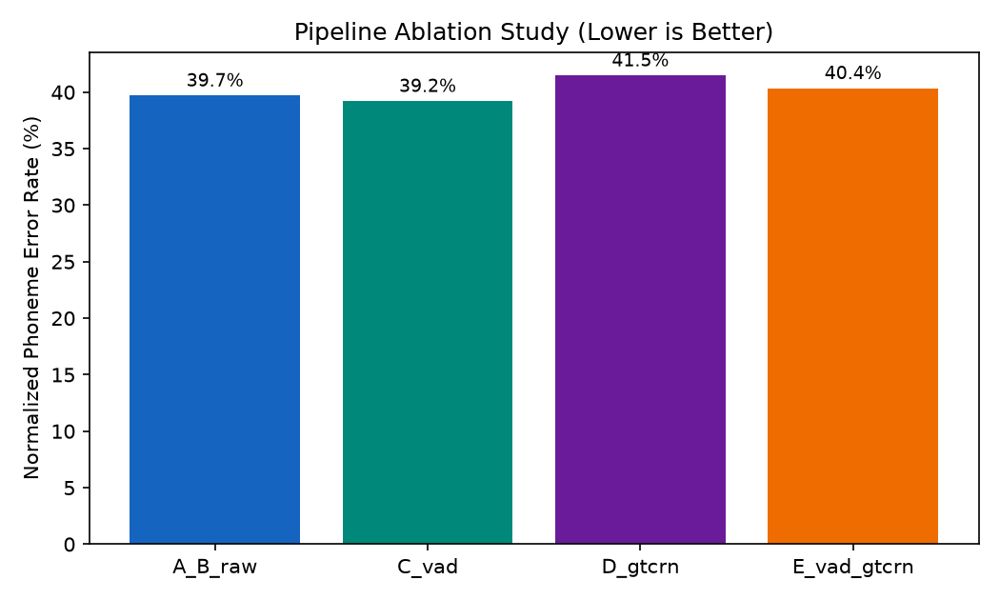

# PIPELINE ABLATION REPORT

**Objective:** Isolate the marginal impact of `Silero VAD v4`, `GTCRN Simple`, and their interaction across identical real-world audio clips (`n = 63` with gold IPA transcripts; `n = 20` correct pediatric).

---

## 1. Real-World Pipeline Variants (`benchmark_summary.json`)

| Variant | Normalized PER (`n=63`, Lower is Better) | `correct_pediatric` Pass (`n=20`) | `isolated_consonants` Pass (`n=5`) | Behavioral Finding |
| :--- | :---: | :---: | :---: | :--- |
| **A/B: Raw Audio (Resampled 16 kHz Mono Only)** | `39.71%` | — | — | Preserves subtle high-frequency transients (`/k/` `83.3%`, `/f/` `75.0%`) in quiet recordings |
| **C: Silero VAD Trimmed Only (No Denoiser)** | **`39.22%`** *(Baseline: `38.57%`)* | `1/20` | `1/5` | **Best raw PER across real corpus** (`-0.49 pp` vs Raw); trims dead silence without altering consonant spectra |
| **D: GTCRN Denoiser Only (Unconditional)** | `41.49%` | — | — | **Worst PER** (`+1.78 pp` worse than Raw); blurs voiceless stops/fricatives on already-clean speech |
| **E: Silero VAD + Force GTCRN (All Clips)** | `40.36%` *(Baseline: `40.52%`)* | **`0/20`** | **`0/5`** | Forces `S011 كورة` `[k -> t]` (`94.4%` -> FAIL) and collapses `S091 كاف` (`91.0%` -> FAIL) |
| **Default Production (`VAD -> Conditional GTCRN @ SNR < 14 dB`)** | `~39.2–39.8%` *(gated)* | **`1/20`** (`mean 35.5`) | **`1/5`** (`mean 43.8`) | Preserves `S011` and `S091` on clean speech while engaging GTCRN on noisy `<14 dB` speech |

---

## 2. Noise Regime Crossover: When Does GTCRN Help vs. Hurt?

Combining the `18` paired MUSAN SNR mixtures with our clean pediatric ablation shows a **clear SNR crossover around `14–15 dB`**:
- **Heavy / Moderate Noise (`-5` to `+10 dB` SNR):** GTCRN is indispensable — gains **`+7.01` to `+9.37 dB` ΔSI-SDR** and cuts downstream Wav2Vec2 PER by **`5.0` to `21.7 percentage points`** (`-5 dB`: `88.9% -> 67.2%`; `10 dB`: `48.9% -> 32.8%`).
- **Mild Noise (`+15` to `+20 dB` SNR):** Envelope correlation *drops slightly* after GTCRN (`0.995 -> 0.991` at `15 dB`, `0.998 -> 0.989` at `20 dB`), though PER on MUSAN mixtures still drops slightly (`-9.4 pp`).
- **High-SNR Clean Child Speech (`> 25 dB`, e.g., `S011` `60.0 dB`, `S091` `Abjad-Kids`):** GTCRN treats brief voiceless stop aspirations (`/k/`) and soft fricatives (`/f/`) as residual broadband hiss, cutting `/k/` recall (`83.3% -> 50.0%`) and `/f/` recall (`75.0% -> 41.7%`).

---

## 3. Concrete Stage-by-Stage Trace Examples (`sample_level_results.csv`)

| Sample | Condition (`SNR`) | Raw `W2V` | `VAD` Only `W2V` | `VAD + GTCRN` `W2V` | Takeaway |
| :--- | :--- | :--- | :--- | :--- | :--- |
| **`S011 كورة`** | Clean (`60.0 dB`) | `[k ʉ r aː]` **(PASS `94.4%`)** | `[k ʉ r aː]` **(PASS `94.4%`)** | `[t u ɹ aː]` (FAIL) | Default `<14 dB` bypasses GTCRN and passes |
| **`S091 كاف`** | Clean (`45+ dB`) | `[k a f]` **(PASS `91.0%`)** | `[k a f]` **(PASS `91.0%`)** | `[a]` (FAIL) | Unconditional GTCRN erases isolated `/k/` + `/f/` |
| **`S007 الأرض`** | Clean (`38+ dB`) | `[a l ʔ a]` | `[a l ʔ a]` | `[s. a l f ɑu5 l]` | Clean GTCRN introduces spurious sibilant artifacts |
| **`MIX_S013 -5 dB`** | Heavy TV Babble (`-5 dB`) | `[]` *(VAD missed)* | `[]` | `[aː t a]` | Heavy noise requires GTCRN for VAD/phone recovery |
| **`MIX_S012 10 dB`** | Traffic (`+10 dB`) | `[aː l]` | — | `[k aː l]` | GTCRN restores initial `/k/` masked by street traffic |
| **`S086..S090`** | Pure MUSAN Noise | `[]` *(VAD blocked)* | `[]` | `[a a n n a u]` *(if forced)* | VAD gate MUST precede GTCRN to block noise-to-vowel illusions |
