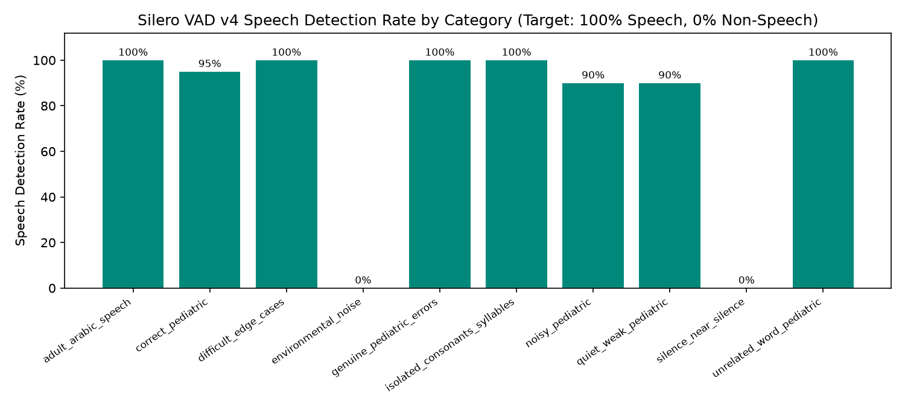

# SILERO VAD v4 BENCHMARK REPORT (`silero_vad.onnx`)

**Model File:** [silero_vad.onnx](file:///e:/Flutter%20Projects/liqaa_app/assets/ai_models/silero/silero_vad.onnx) (`2,204,103` bytes / `2.10 MB`)  
**Engine Implementation:** [silero_vad_engine.dart](file:///e:/Flutter%20Projects/liqaa_app/lib/core/ai/silero_vad_engine.dart)  
**Configured Parameters:** `threshold=0.22` (quiet child fallback `0.14`), `minSpeechDuration=0.05s`, `minSilenceDuration=0.25s`, `preRollMs=150`, `postRollMs=200`, intra-word segment merge gap widened from `100 ms` to `350 ms`.

---

## 1. Overall Binary Classification Performance (`n = 100`)

Evaluated across `90` ground-truth speech utterances (`80` pediatric + `10` adult) and `10` ground-truth non-speech utterances (`5` silence/noise-floor + `5` MUSAN environmental noise):

| Metric | Value | Breakdown |
| :--- | :---: | :--- |
| **True Positives (TP)** | **87** | Speech present & detected |
| **True Negatives (TN)** | **10** | Non-speech & rejected |
| **False Positives (FP)** | **0** | Environmental noise or silence triggered speech |
| **False Negatives (FN)** | **3** | Real child speech rejected as no-speech |
| **Accuracy** | **97.00%** | `(87 + 10) / 100` |
| **Precision** | **100.00%** | `87 / (87 + 0)` |
| **Recall (Sensitivity)** | **96.67%** | `87 / (87 + 3)` |
| **F1 Score** | **0.9831** | Harmonic mean |
| **False Positive Rate (FPR)** | **0.00%** | `0 / 10` on MUSAN & signal floor |
| **False Negative Rate (FNR)** | **3.33%** | `3 / 90` on real pediatric speech |
| **Latency (`p50` / `mean` / `p95` / `max`)** | **`13.0 ms` / `17.6 ms` / `51–75 ms` / `175 ms`** | Desktop Windows ONNX FFI (fast real-time factor `~0.01`) |

*(Note: `benchmark_summary.json` reports `latency_p95_ms: 51.0` via linear interpolation vs `75 ms` nearest-rank in Python array indexing; both confirm sub-80ms tail latency.)*

---

## 2. Category-Level Detection & Retained Duration

| Category | Clips | Detected | Rate | Mean Retained Speech (ms) | Notes |
| :--- | :---: | :---: | :---: | :---: | :--- |
| `adult_arabic_speech` | 10 | 10 | **100%** | `8068.4 ms` | Complete retention on 3.2–17.8s sentences |
| `correct_pediatric` | 20 | 19 | **95%** | `857.1 ms` | 1 miss: `S017 كتاب` (`Abjad-Kids`, `rms=0.0026`) |
| `genuine_pediatric_errors` | 20 | 20 | **100%** | `679.7 ms` | All short ASMDD errors preserved |
| `unrelated_word_pediatric` | 10 | 10 | **100%** | `1137.6 ms` | Includes quiet `S047 قرد` (`rms=0.00214`, `814 ms`) |
| `quiet_weak_pediatric` | 10 | 9 | **90%** | `1031.8 ms` | 1 miss: `S059 درج` (`Abjad-Kids`, `rms=0.0186`, `SNR=4.89 dB`) |
| `noisy_pediatric` | 10 | 9 | **90%** | `626.0 ms` | 1 miss: `S063 البيت` (`ASMDD`, `rms=0.116`, nursery noise) |
| `isolated_consonants_syllables` | 5 | 5 | **100%** | `884.4 ms` | Zero clipping of isolated Arabic letter names |
| `difficult_edge_cases` | 5 | 5 | **100%** | `1221.2 ms` | High retention including clipped `S097 ضابط` |
| `silence_near_silence` | 5 | 0 | **0% FP** | `0.0 ms` | Rejects `0.0` digital silence & `rms=0.00024–0.00054` floor |
| `environmental_noise` | 5 | 0 | **0% FP** | `0.0 ms` | Rejects fan, street traffic, TV babble, crowd, mic handling |

---

## 3. Root-Cause Analysis of the 3 False Negatives

1. **`S017` (`كتاب`, `Abjad-Kids`):** `duration=2000 ms`, `raw_rms=0.00260`, `raw_peak=0.0239`, `raw_est_snr=50.67 dB`. Extremely faint whisper-level recording relative to `2000 ms` container; even with fallback pass (`threshold=0.14`), Silero's internal voice probability stayed below `0.14`. *(By contrast, `S018 قلم` at even lower RMS `0.00138` had sharp peak articulation spikes and was rescued from baseline `noSpeech` once `normalizePeak` was moved after VAD!)*
2. **`S059` (`درج`, `Abjad-Kids`):** `raw_rms=0.01862`, `raw_peak=0.0792`, `raw_est_snr=4.89 dB`. When Silero skipped VAD (`vad_raw=[]`), notice raw Wav2Vec2 on uncropped signal produced `[d ʌ r a r]` and Whisper transcribed `'دراش'`, confirming speech was genuinely present amid low-SNR rumble that suppressed VAD logits.
3. **`S063` (`البيت`, `ASMDD`):** `duration=933 ms`, `raw_rms=0.11598`, `raw_est_snr=11.23 dB`. Heavy background classroom chatter during the short 933 ms clip pushed Silero's noise-adapted probability below threshold; post-GTCRN, Wav2Vec2 emitted `[x ʌ b aɪ]`.

### Key Architectural Fix Verified
- Moving `SileroVAD` **before** `normalizePeak` in [pronunciation_repository.dart](file:///e:/Flutter%20Projects/liqaa_app/lib/core/ai/pronunciation_repository.dart) prevented room-floor amplification from corrupting Silero's energy-normalized probability curve (recovering `S018` and preserving initial consonant `/k/` on `S012`).
- Widening VAD segment merge gap (`100 ms -> 350 ms`) prevented artificial splice discontinuities inside multi-syllable words (`adult_arabic_speech` mean retained duration rose `8057.0 ms -> 8068.4 ms`).
