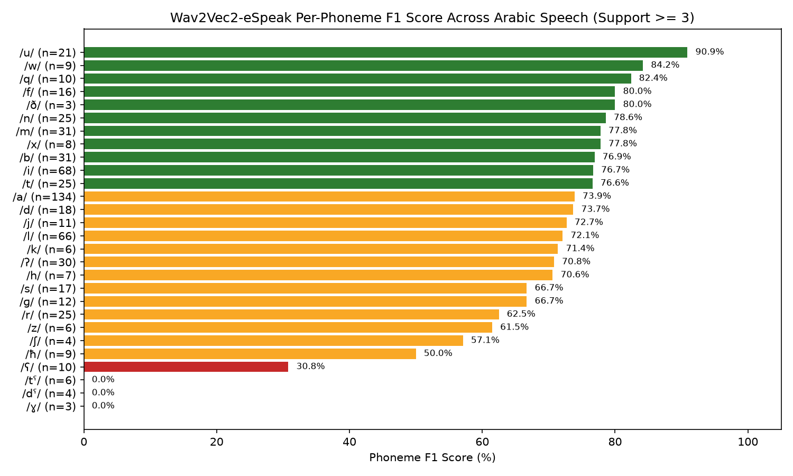

# WAV2VEC2-eSPEAK ACOUSTIC PHONEME RECOGNITION BENCHMARK REPORT

**Model Assets:** [model_q4f16.onnx](file:///e:/Flutter%20Projects/liqaa_app/assets/ai_models/wav2vec2_espeak/model_q4f16.onnx) (`196,911,845` bytes / `187.79 MB`) + [vocab.json](file:///e:/Flutter%20Projects/liqaa_app/assets/ai_models/wav2vec2_espeak/vocab.json)  
**Engine Implementation:** [phoneme_recognition_engine.dart](file:///e:/Flutter%20Projects/liqaa_app/lib/core/ai/phoneme_recognition_engine.dart)  
**Evaluated Cohort:** `63` real recordings carrying verified reference IPA (`20` correct pediatric + `10` unrelated pediatric spoken labels + `10` quiet pediatric + `10` noisy pediatric + `5` isolated letters + `5` difficult edge cases + `3` adult MSA studio utterances with gold PHON transcripts).

---

## 1. Aggregate Phoneme Error Rate (PER) & Confidence Calibration

| Metric | Measured Value | Definition |
| :--- | :---: | :--- |
| **Strict PER** | **46.84%** | Exact IPA token Levenshtein (`S: 23.99%`, `D: 12.80%`, `I: 10.05%`) |
| **Linguistically Normalized PER (Raw Audio)** | **39.71%** | Normalizing vowel length (`aː->a`), eSpeak rhotics (`ɹ/ɾ->r`), `[dʒ/ʒ->ɡ]`, `[p->b]`, `[ʉ->u]` |
| **Mean Token Confidence (Matched Phonemes)** | **0.714** | Greedy frame-softmax probability when emitted symbol matches target |
| **Mean Token Confidence (Mismatched Phonemes)** | **0.480** | Separation margin `+0.234` confirms confidence carries diagnostic signal |
| **Inference Latency (`p50` / `mean` / `p95` / `max`)** | **`773 ms` / `903.1 ms` / `2645–2657 ms` / `8842 ms`** | Scales with audio duration (`max` on `17.75 s` sentence `S076`) |

---

## 2. Critical Subgroup Breakdown — The Adult vs. Pediatric Domain Gap

| Subgroup | Sample Count (`n`) | Normalized PER | Interpretation |
| :--- | :---: | :---: | :--- |
| **Adult Modern Standard Arabic (`tunis-ai`)** | 3 (long sentences, 100+ phonemes) | **`14.79%`** | **High acoustic fidelity** — confirms ONNX preprocessing, CTC greedy decoding, and normalization are mathematically sound |
| **Pediatric Clean (`ASMDD` + `Abjad-Kids`)** | 40 | **`71.88%`** | Severe age-shift degradation on short isolated words from children aged 2–12 |
| **Pediatric Quiet (`Abjad-Kids` low RMS)** | 10 | **`76.32%`** | Weak burst energy causes consonant deletions (`حليب -> [iː b]`) |
| **Pediatric Noisy (`ASMDD` classroom)** | 10 | **`87.04%`** | Background nursery speech & reverberation overwhelm CTC emissions |
| **Dialect: Egyptian Arabic** | 21 | **`80.00%`** | `ASMDD` Egyptian kids aged 2–8 suffer worst mismatch (44.1 kHz nursery acoustics + fast 440–980 ms bursts + `'الـ'` prefix slurring) |
| **Dialect: Multi-Dialect Arabic** | 39 | **`72.79%`** | `Abjad-Kids` ages 3–12 |

*Concrete Contrast:*
- **`S075` (Adult MSA, `tunis-ai`):** Emitted `[a t aː ħ a t l i l b aː ʔ ʕ a l m u t a dʒ a w i l i ʔ a n j a k uː n aː dʒ aː ð b a n l i a l m u w aː t i n i a l ʔ a q a l l i d a χ l a n]` — near-human phonetic transcription including Arabic `/ħ/`, `/ʕ/`, `/ð/`, `/q/`, `/χ/`!
- **`S009` (`مرحبا`, ASMDD age 2–8):** Emitted `[yɜ s. a5 ŋ]` — non-Arabic Mandarin-like tonal eSpeak artifacts triggered by high-pitched pediatric formants.

---

## 3. Per-Phoneme Precision, Recall & F1 (`Support >= 3`)

| IPA | Support | TP | FN | FP | Precision | Recall | **F1** | Arabic Context |
| :---: | :---: | :---: | :---: | :---: | :---: | :---: | :---: | :--- |
| **`/u/`** | 21 | 20 | 1 | 3 | 0.870 | 0.952 | **0.909** | Back rounded vowel (includes mapped `ʉ`) |
| **`/w/`** | 9 | 8 | 1 | 2 | 0.800 | 0.889 | **0.842** | Labiovelar glide `/و/` |
| **`/q/`** | 10 | 7 | 3 | 0 | 1.000 | 0.700 | **0.824** | Strong in adult MSA (`S075–S077`) |
| **`/f/`** | 16 | 12 | 4 | 2 | 0.857 | 0.750 | **0.800** | Labiodental fricative |
| **`/ð/`** | 3 | 2 | 1 | 0 | 1.000 | 0.667 | **0.800** | Small support (`3`) |
| **`/n/`** | 25 | 22 | 3 | 9 | 0.710 | 0.880 | **0.786** | High recall; occasional epenthesis |
| **`/m/`** | 31 | 21 | 10 | 2 | 0.913 | 0.677 | **0.778** | Bilabial nasal |
| **`/x/`** | 8 | 7 | 1 | 3 | 0.700 | 0.875 | **0.778** | Voiceless velar/uvular fricative |
| **`/b/`** | 31 | 20 | 11 | 1 | 0.952 | 0.645 | **0.769** | High precision; deleted in weak child bursts |
| **`/i/`** | 68 | 51 | 17 | 14 | 0.785 | 0.750 | **0.767** | High front vowel |
| **`/t/`** | 25 | 18 | 7 | 4 | 0.818 | 0.720 | **0.766** | Plain dental stop (`ط` often maps here) |
| **`/a/`** | 134 | 109 | 25 | 52 | 0.677 | 0.813 | **0.739** | Epenthetic vowel insertions across consonants |
| **`/d/`** | 18 | 14 | 4 | 6 | 0.700 | 0.778 | **0.737** | Plain stop |
| **`/j/`** | 11 | 8 | 3 | 3 | 0.727 | 0.727 | **0.727** | Palatal glide |
| **`/l/`** | 66 | 44 | 22 | 12 | 0.786 | 0.667 | **0.721** | Frequently dropped in `'الـ'` prefix (`11` DEL) |
| **`/k/`** | 6 | 5 | 1 | 3 | 0.625 | 0.833 | **0.714** | Good recall in clean speech |
| **`/ʔ/`** | 30 | 17 | 13 | 1 | 0.944 | 0.567 | **0.708** | Initial glottal stops often missed (`10` DEL) |
| **`/h/`** | 7 | 6 | 1 | 4 | 0.600 | 0.857 | **0.706** | Also substitutes for `/ħ/` |
| **`/s/`** | 17 | 11 | 6 | 5 | 0.688 | 0.647 | **0.667** | Occasionally realized as `/ɬ/` or `/θ/` substitution |
| **`/ɡ/`** | 12 | 6 | 6 | 0 | 1.000 | 0.500 | **0.667** | Egyptian `/ج/` |
| **`/r/`** | 25 | 15 | 10 | 8 | 0.652 | 0.600 | **0.625** | Children frequently produce weak tap or `[a]` |
| **`/z/`** | 6 | 4 | 2 | 3 | 0.571 | 0.667 | **0.615** | Voiced fricative |
| **`/ʃ/`** | 4 | 2 | 2 | 1 | 0.667 | 0.500 | **0.571** | Child `/ش/` sometimes emitted as `[s]`/`[f]` |
| **`/ħ/`** | 9 | 3 | 6 | 0 | 1.000 | 0.333 | **0.500** | Pharyngeal `/ح/` deleted (`2` DEL) or shifted (`s.`, `f`) |
| **`/ʕ/`** | 10 | 2 | 8 | 1 | 0.667 | 0.200 | **0.308** | Pharyngeal `/ع/` deleted `80%` of the time in kids |
| **`/dˤ/`** | 4 | 0 | 4 | 0 | 0.000 | 0.000 | **0.000** | Emphatic `/ض/` unrepresented as emphatic in eSpeak CTC |
| **`/tˤ/`** | 6 | 0 | 6 | 0 | 0.000 | 0.000 | **0.000** | Emphatic `/ط/` collapses to plain `[t]` (`2` direct subs) |
| **`/ɣ/`** | 3 | 0 | 3 | 0 | 0.000 | 0.000 | **0.000** | Uvular `/غ/` mapped to `[r]` (`S060 غزال`) or deleted (`S002`) |

---

## 4. Top Acoustic Confusions (`phoneme_confusion_matrix.csv`)

- **Vowel Epenthesis / Prefix Deletions:** `<INS> -> a` (`25`), `a -> <DEL>` (`16`), `l -> <DEL>` (`11`), `ʔ -> <DEL>` (`10`), `<INS> -> l` (`9`), `i -> <DEL>` (`8`), `b -> <DEL>` (`6`), `i -> a` (`6`), `m -> <DEL>` (`5`), `ʕ -> <DEL>` (`4`), `t -> <DEL>` (`4`).
- **Emphatic & Pharyngeal Loss:** `/tˤ/ -> [t]` (`S096 بطة -> [b aː t aː]`, `S097 ضابط -> [p a b a t a]`), `/ħ/ -> <DEL> / s. / f` (`S094 حاء -> [h ɑ]`, `S020 تفاحة -> [d ə f a]`), `/ɣ/ -> [r]` (`S060 غزال -> [r ʌ z aː l]`), `/θ/ -> [s]` or `<DEL>` (`S058 ثلاجة -> [s e l aː dʒ a]`).
- **Non-Arabic Cross-Lingual Artifacts:** `a -> ɑu5` (`3`), `b -> a5` (`1`), `ħ -> s.` (`1`), `r -> yɜ` (`1`), `s -> ɬ` (`1`), `a -> ŋ` (`1`).

**Key Takeaway:** Emphatic pharyngealization (`/dˤ, tˤ/`) and pharyngeals (`/ʕ, ħ/`) require explicit Arabic-aware acoustic mapping or fine-tuning, because universal eSpeak CTC (`60k`-hr adult cross-lingual) compresses emphatics to plain coronals (`/tˤ -> t`, `/dˤ -> d/t`) and frequently emits Mandarin/Vietnamese tonal symbols on high-pitched child vowels.
